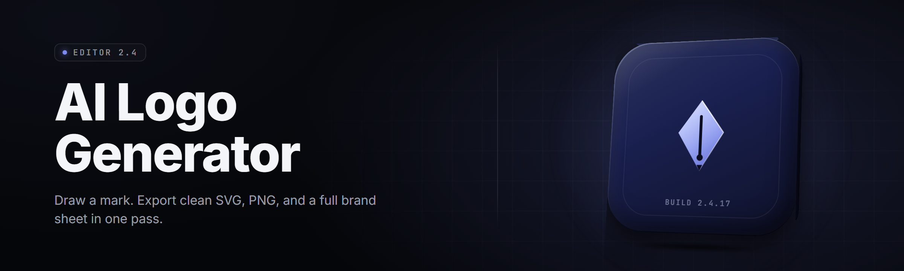

  
  
  

  

  
  

---

A local, offline-first desktop application that turns a text prompt into a finished, vector-ready logo. No cloud calls, no subscription, no watermark. You describe the brand, the studio generates concepts, you refine, export. Built for founders, indie hackers, and design-shop folks who need twenty options before lunch.

---

## 📖 Table of Contents

- [Overview](#-overview)
- [What is AI Logo Generator Studio](#-what-is-ai-logo-generator-studio)
- [Key Features](#-key-features)
- [The Problem](#-the-problem)
- [The Solution](#-the-solution)
- [Quick Start](#-quick-start)
- [Grouped Module Catalog](#-grouped-module-catalog)
- [Comparison](#-comparison)
- [System Requirements](#-system-requirements)
- [Installation](#-installation)
- [Known Issues](#-known-issues)
- [Module Status](#-module-status)
- [Usage Guidelines](#-usage-guidelines)
- [FAQ](#-faq)

---

## 🗂️ Overview

| Category | Details |
|---|---|
| **Product** | AI Logo Generator Studio |
| **Version** | 2.4.1 (2026 release channel) |
| **Platform** | Windows 10 / 11 (x64) |
| **Runtime** | Standalone `.exe` — no Python, no Node, no Docker |
| **Model** | Local diffusion + vectorizer pipeline, 4 model packs |
| **Export** | SVG, PNG, PDF, EPS, WebP, favicon sets |
| **License** | MIT (application), models under research license |

The studio ships as a single portable executable. Everything — the prompt engine, the four generation model packs, the vectorization stage, and the brand-kit exporter — runs on your machine against your GPU or CPU. You are not uploading pitches to someone else's server.

---

## 🧠 What is AI Logo Generator Studio

| Term | Explanation |
|---|---|
| **Prompt Engine** | Natural-language parser that maps your brand description to a generation seed |
| **Model Pack** | A bundled weight set tuned for a specific logo style (geometric, mascot, wordmark, emblem) |
| **Vectorizer** | Converts raster generations into clean SVG paths via the built-in tracer |
| **Brand Kit** | A saved bundle of logo, palette, type recommendation, and export presets |
| **Seed Lock** | Freezes the generation noise so you can re-run variations on a single concept |
| **Icon Matrix** | Grid view of 48 simultaneous generations for rapid triage |

**Why builders pick it up:**

- Runs fully offline — your unannounced brand never leaves the machine
- 48 concepts per batch, not one at a time
- Exports real vector SVG, not a flattened raster pretending to be a logo
- No credits, no monthly cap, no account wall
- Portable — drop the folder on a USB stick and it runs

---

## ✨ Key Features

| Feature | Description | Benefit |
|---|---|---|
| **Prompt Fabricator** | Describe in plain English; the engine expands to weighted generation tokens | Skip prompt-engineering school |
| **48-Up Icon Matrix** | One click renders 48 variations at 512px | Pick from a wall, not a whisper |
| **Style Lock** | Pin one axis (palette, geometry, weight) and vary the rest | Iterate without losing the thread |
| **Live Vectorizer** | Tracer runs on the selected concept in under 2 seconds | Get SVG without a round trip to Illustrator |
| **Palette Synthesizer** | Extracts 5–7 brand colors from the chosen logo | Brand kit falls out of the design |
| **Font Suggester** | Recommends 3 paired typefaces from a local library | Wordmark-ready in the same session |
| **Mockup Preview** | Renders logo on business card, sign, app icon, and shirt | Judge it in context, not on white |
| **Batch Queue** | Queue 20 prompts and walk away | Overnight generation runs |
| **Version History** | Every save is versioned locally with a diff thumbnail | Roll back a bad pivot |
| **Brand Kit Export** | One zip: logos, palette, type, guidelines PDF | Hand off to a client in minutes |
| **Negative Prompting** | Tell it what to avoid ("no serifs, no gradients") | Kill the styles you hate fast |
| **Presets Library** | 60+ starting presets by industry | Skip the blank canvas |

---

## 💢 The Problem

Building a logo the conventional way is a grind, and the shortcut tools are worse:

- Cloud generators upload your unreleased brand and pitch to a server you don't control.
- Free tiers watermark the export or cap you at 3 downloads a month.
- Raster-only output means the "logo" breaks the moment you scale it past 800px.
- One-at-a-time generation means you stare at a single mediocre result and talk yourself into it.
- Subscription lock-in for a thing you might touch twice a year.
- No offline mode — plane wifi dies, your workflow dies.
- Vector export is hidden behind a paywall or a second tool.

---

## ✅ The Solution

| Problem | Solution |
|---|---|
| Cloud uploads your brand | 100% local generation, zero network calls |
| Watermarks and credit caps | No watermark, no cap, no account |
| Raster-only output | Built-in tracer exports true SVG |
| One-at-a-time | 48-up icon matrix per batch |
| Subscription lock-in | One-time download, runs forever offline |
| No offline mode | Fully offline, portable executable |
| Hidden vector paywall | SVG, EPS, and PDF export in every tier |

---

## ⚡ Quick Start

1. 📄 Visit the project page and grab the current release.
2. 📁 Extract the archive to any folder — no installer required.
3. ▶️ Run the `.exe` — first launch unpacks the model packs (~1.2 GB).
4. ✍️ Type a brand description, hit **Generate**, watch the 48-up matrix fill.
5. 💾 Pick a concept, hit **Vectorize**, then **Export Brand Kit**.
### ⬇️ Get AI Logo Generator Studio

  

---

## 🧩 Grouped Module Catalog

### 🎯 Prompt & Generation

The prompt fabricator is where a sentence becomes a seed. Write "minimalist fintech mark, single geometric glyph, deep navy," and the engine expands it into weighted generation tokens. It understands industry, mood, geometry preference, and color intent — and it flags contradictions before you waste a generation cycle.

- **Prompt Fabricator** — NLP expansion to generation tokens
- **Negative Prompting** — explicit style exclusions
- **Seed Lock** — freeze noise, vary one axis
- **Batch Queue** — 20+ queued prompts
- **Preset Library** — 60+ industry starts
- **Prompt History** — recall and star past prompts

### 🎨 Generation Model Packs

Four tuned weight sets ship in the box. Each targets a family of logo styles, and you can run any two side by side for a split-screen bake-off. The packs are quantized to fit consumer GPUs and fall back to CPU if no discrete card is present.

- **Geometric Pack** — abstract marks, grids, glyphs
- **Mascot Pack** — character and creature logos
- **Wordmark Pack** — typography-led marks
- **Emblem Pack** — badge, crest, and seal styles
- **Split Preview** — run two packs in parallel
- **Seed Import** — reuse a seed from a past session

### 🖋️ Vectorization & Export

The tracer is the part most tools hide behind a paywall. Here it runs locally on the selected concept the moment you ask, converting the raster into clean bezier paths you can open in any vector editor. Export presets cover everything from a favicon set to a print-ready EPS.

- **Live Vectorizer** — sub-2s raster-to-SVG
- **Path Optimizer** — reduce node count without shape loss
- **Favicon Set** — 16/32/48/64/128/256 in one click
- **EPS Export** — print-ready vector
- **PDF Brand Sheet** — logo + palette + type on one page
- **WebP Export** — small, sharp web previews

### 🎛️ Brand Kit & Refinement

Once a concept lands, the studio builds the rest of the kit around it — palette, type, and mockups — so you hand off a system, not a single file. Refinement tools sit right next to the canvas so you can nudge geometry and color without re-generating.

- **Palette Synthesizer** — 5–7 brand colors extracted
- **Font Suggester** — 3 paired typeface recommendations
- **Mockup Preview** — card, sign, icon, shirt
- **Version History** — local diff-able saves
- **Brand Kit Export** — one zip, full handoff
- **Manual Nudge** — adjust anchor points by hand

---

## 📊 Comparison

| Aspect | Cloud Generators | Classic Vector Suites | This Tool |
|---|---|---|---|
| Offline | ❌ Requires network | ✅ Yes | ✅ Fully offline |
| Watermark on free tier | ⚠️ Often | ❌ N/A | ✅ Never |
| Vector export | ⚠️ Paywalled | ✅ Native | ✅ Built-in tracer |
| Concepts per batch | 1–4 | Manual | 48 |
| Price model | Subscription | $20+/mo | One download |
| Brand upload | ⚠️ Sent to servers | ❌ Local | ✅ Stays local |
| Learning curve | Low | High | Low |
| Portable | ❌ | ❌ | ✅ USB-runnable |

---

## 🖥️ System Requirements

| Component | Minimum | Recommended |
|---|---|---|
| OS | Windows 10 (x64) | Windows 11 (x64) |
| CPU | 4-core, SSE4.2 | 8-core, AVX2 |
| RAM | 8 GB | 16 GB |
| GPU | Integrated / CPU fallback | 6 GB VRAM (CUDA or DirectML) |
| Disk | 3 GB free | 6 GB free (SSD) |
| Display | 1366×768 | 1920×1080 |
| .NET | Bundled (self-contained) | Bundled |

---

## 📦 Installation

1. **Grab the release.** From the project page, download the latest `.exe` archive. Verify the checksum published with the release if your network is untrusted.

2. **Extract.** Right-click → *Extract All* to any folder you own (avoid Program Files to prevent permission prompts). The folder is fully portable.

3. **Run the `.exe`.** First launch unpacks the four model packs. Windows SmartScreen may prompt on first run because the binary is unsigned — choose *More info → Run anyway*. Subsequent launches are instant.

---

## 🐞 Known Issues

| Issue | Solution |
|---|---|
| First launch slow (model unpack) | Expected; runs once, ~1.2 GB |
| SmartScreen warning on first run | Unsigned binary — use *More info → Run anyway* |
| GPU fallback to CPU on older cards | Set `--cpu` flag or update GPU drivers |
| Tracer misses thin strokes | Raise *Trace Detail* to High in Export settings |
| Favicon set exports blurred at 256 | Enable *Supersample* before export |
| History folder grows large | Set *Keep last N versions* to 20 in Preferences |

---

## 📋 Module Status

| Module | Status | Description |
|---|---|---|
| Prompt Fabricator | ✅ Working | NLP to generation tokens |
| 48-Up Icon Matrix | ✅ Working | Batch generation grid |
| Live Vectorizer | ✅ Working | Raster-to-SVG tracer |
| Palette Synthesizer | ✅ Working | Brand color extraction |
| Font Suggester | ✅ Working | Typeface pairing engine |
| Mockup Preview | ✅ Working | Context renderer |
| Brand Kit Export | ✅ Working | Zipped handoff |
| Batch Queue | ✅ Working | Deferred generation |
| Version History | ✅ Working | Local diff-able saves |
| Split Preview | ✅ Working | Two-pack side-by-side |
| EPS Export | ✅ Working | Print-ready vector |
| PDF Brand Sheet | ✅ Working | One-page spec |
| Manual Nudge | 🧪 Beta | Anchor-point editing |
| Cloud Sync | 🚧 Planned | Optional encrypted sync |

---

## 🚦 Usage Guidelines

| Allowed | Not allowed |
|---|---|
| Generate logos for your own brand | Reselling packaged model packs |
| Use for client work and handoffs | Redistributing the `.exe` as your own product |
| Modify and fork under MIT | Removing license and attribution headers |
| Batch-generate for design exploration | Training third-party models on bundled packs |
| Share generated logos commercially | Reverse-engineering the tracer for a closed product |

---

## 🤔 FAQ

Does it need an internet connection?

No. Generation, vectorization, and export all run locally. The only time you touch the network is downloading the release archive itself.

Is the output really vector, or a renamed PNG?

Really vector. The tracer produces bezier paths you can open in Illustrator, Inkscape, or Figma and edit node by node.

Can I use generated logos commercially?

Yes. The application is MIT-licensed, and the logos you generate are yours to use without attribution.

Will it run on a laptop without a dedicated GPU?

Yes. The CPU fallback works, just slower — expect 3–5× the generation time. A 6 GB VRAM card is the sweet spot.

Why does SmartScreen flag the first launch?

The `.exe` is unsigned, so Windows can't verify the publisher. The release page publishes checksums you can verify independently.

How big is the download?

The archive is roughly 900 MB; first launch unpacks model packs to about 1.2 GB. Total on-disk is ~3 GB.

Can I add my own model packs?

Yes. Drop a compatible pack into the `packs/` folder and it appears in the pack selector on next launch.

Does it support non-Latin wordmarks?

The Wordmark Pack includes a Latin and extended-CJK glyph set. Full RTL shaping is on the roadmap for 2.5.

Is there a portable/no-install mode?

The whole folder is portable — copy it to a USB stick and it runs on any compatible Windows machine.

How often are model packs updated?

Packs ship on the major release channel; minor pack patches land between versions and are pulled from the same project page.

---

## 🏁 Closing

AI Logo Generator Studio is built for the moment between the idea and the pitch deck — when you need a real mark now, not a mood board next week. It runs on your machine, exports real vectors, and hands you a finished brand kit before your coffee cools. Fork it, extend it, or just use it to ship the thing you've been putting off.

### ⬇️ Download the latest build

  

